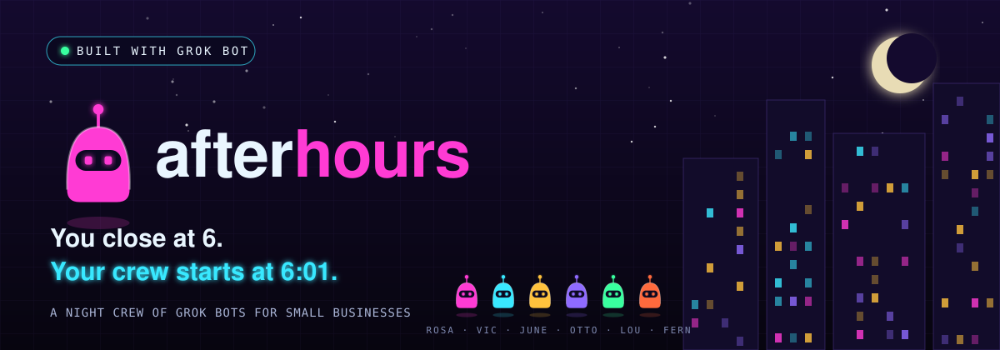
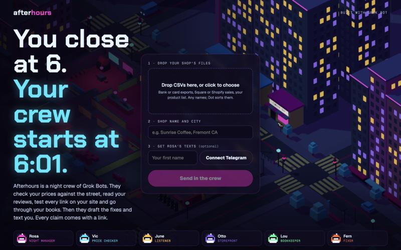
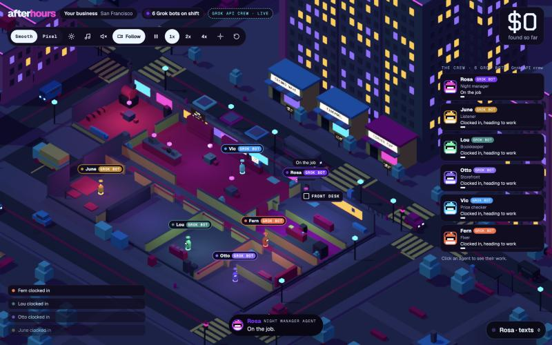
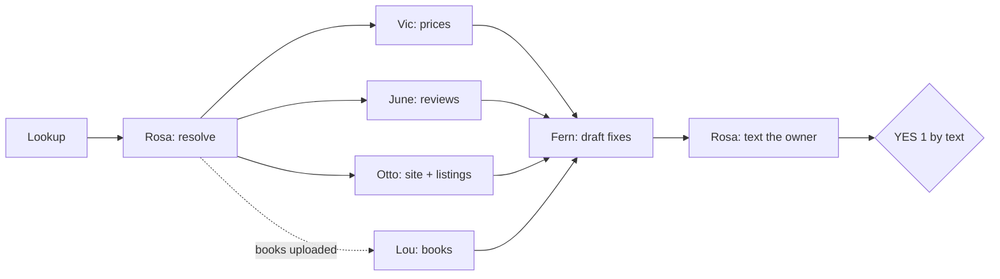

<p align="center">
  
</p>

<p align="center">
  <a href="https://afterhours-picky9.vercel.app"></a>
  
  
  
</p>

<p align="center">
  <b>A night crew of Grok Bots for small businesses.</b><br>
  Name any real business. The crew checks its prices against the street, reads its reviews, tests every link on its site<br>
  and goes through its books. Then it drafts the fixes and texts the owner. <b>Every claim comes with a link.</b>
</p>

<p align="center">
  <a href="https://afterhours-picky9.vercel.app">Live app</a> ·
  <a href="docs/MVP_SPEC.md">How it works</a> ·
  <a href="grokbot/BOTS.md">The crew's job descriptions</a> ·
  <a href="grokbot/setup/README.md">Run the crew as Grok Bots</a>
</p>

<p align="center"><sub>Berkeley × Stanford hackathon · Nov 19, 2026</sub></p>



## Meet the crew

Seven agents, one night shift. Six of them are **real Grok Bots**, each with its own skill, routine and webhook, wired to Afterhours over MCP. Dot runs inside the upload itself. The same job descriptions also run on Grok 4.7 through the xAI API for speed.

| | Bot | Job |
| --- | --- | --- |
|  | **Rosa**, night manager | Finds the business, its hours and its prices. Texts the owner, and the owner approves by replying `YES 1` |
|  | **Vic**, price checker | Walks the street, reads 2–4 competitors' menus and pairs the same item, same size |
|  | **June**, listener | Reads reviews and X posts, groups complaints into themes with real quotes |
|  | **Otto**, storefront | Our own site checker tests every order, menu and booking link; compares hours and phone across listings |
|  | **Lou**, bookkeeper | Duplicate payments, creeping subscriptions and shrinking margins in the owner's own exports |
|  | **Dot**, file clerk | The owner drops every file at once; Dot works out which is expenses, sales or the price list |
|  | **Fern**, fixer | Drafts one fix per finding: the new price, the review reply, the listing update |



## What it found

A real run on production, Philz Coffee at 101 Forest Ave, Palo Alto, picked live and finished in about 3 minutes:

| | |
| --- | --- |
| Menu | 14 real items and prices, each linked to the page they came from |
| Site | 15 pages checked by our own code; order and menu links work |
| Hours | Google says *open daily 5 AM*; the website says *weekdays 4:30 AM* |
| Phone | Google lists a different number from the website |
| Fixes | Fern drafted both listing updates; Rosa texted them, numbered for `YES 1` / `YES 2` |
| Work | 55 Grok calls, 101 web searches, 5 X posts |

## How it stays honest

- **Code computes money, Bots report facts.** A Bot sends a price, a quote or a link, and the engine (`lib/engine`) computes every dollar. A draft with a figure that isn't in the finding's facts gets a **422**.
- **Every claim has a source.** A finding without a registered source gets a **422** too.
- **Estimates say so.** Anything not from the owner's own books is labelled an estimate and lists its assumptions ("Assumes 20 sold a day. Text me the real number").
- **Nothing reaches a third party.** Rosa only texts the owner. We never contact the business we scanned.

## How the crew runs



One tool layer, three ways in: **Grok Bots** call it over MCP (`/api/mcp`), the **xAI API crew** calls it as functions, and you can `curl` it at `/api/agent/<tool>`. Our backend runs the shift and fires each Grok Bot's routine webhook in order. If a Bot hasn't clocked in within 90 s, the API crew takes its job, and the shop says so.

## Run it locally

```bash
git clone https://github.com/nick-devvv/afterhours
cd afterhours
npm install
cp .env.example .env.local   # add XAI_API_KEY at least
npm run dev                  # http://localhost:3000
npm test                     # no keys, no network
```

To run the crew as Grok Bots, follow [`grokbot/setup/`](grokbot/setup/README.md): one paste-ready file per Bot (profile, skill, MCP server, webhook routine).

## Built with

Grok Bot · Grok 4.7 (xAI Responses API, web search, X search) · MCP · Next.js 16 · three.js · Upstash Redis · Telegram · Vercel

## Team

Nick, Darian and Rayyan, each working with their own Grok Bot ([build log](docs/BUILD_LOG.md)). The 3D shop engine started in our earlier project, Plumb (Nov 18); everything else was built today.

Working on the code? Read [`AGENTS.md`](AGENTS.md) first.
