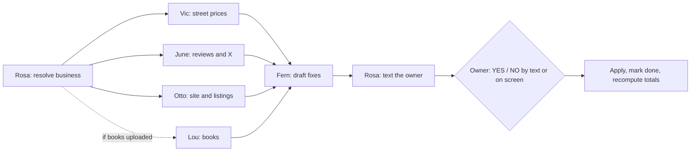
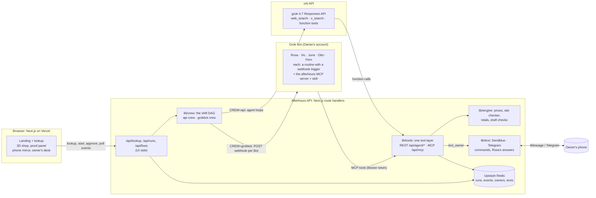

# Afterhours: MVP spec

Last updated: Nov 19, 2026. Team: Nick (frontend and UI, `nick/frontend`), Darian (the whole backend: API, crew, texting, `darian/backend`), Rayyan (the pitch deck and demo, `rayyan/deck`).

**Due 4:45 PM today.** Section 13 is the plan for the time we have. Everything marked P1 or P2 waits until P0 works on the deployed app.

Task lists: [`FRONTEND.md`](FRONTEND.md) (Nick) · [`BACKEND.md`](BACKEND.md) (Darian) · [`DECK.md`](DECK.md) (Rayyan) · [`GROK_BOT.md`](GROK_BOT.md) (everyone: how we build with Grok Bot and how the Grok Bot crew runs).

---

## 1. What Afterhours is

Small business owners close up, go home, and do the books at 11 PM if they do them at all. Meanwhile money leaks in places nobody checks: a latte priced 75 cents under every shop on the block, an online-order link that's been broken for a month, four reviews in a row about the same slow line, Google saying you close at 6 when the door says 5.

**Afterhours is a night crew of Grok Bots for a small business.** Name any real business and the crew goes to work: it reads the business's own website and menu, walks the street to compare prices with real competitors, listens to reviews and X posts, checks every link on the site, and finds where money is leaking. Then it drafts the fixes, and Rosa, the night manager, **texts the owner**. The owner approves by replying `YES 1`. Then the crew keeps watching: every night it runs again, and every morning Rosa texts what changed.

- **Pitch:** "You close at 6. Your crew starts at 6:01."
- **Stage line for the judge's pick:** "Name any business. Any one. In three minutes our crew will tell you where it's losing money, with a link for every claim."
- **What we prove on stage:** real Grok Bots doing real work on a business the judge picks, every number computed by code from real sources, real texts to a real phone, and approvals by text that change the shop on screen.

### Who it's for, and why they come back

| | |
| --- | --- |
| **Who** | Owner-operators of local businesses with 1–20 staff: cafés, bakeries, restaurants, salons, small shops. No CFO, no marketer, no analyst. They live on their phone, not in dashboards. |
| **Persona** | Maya owns a two-location café. She opens at 6:30 AM, closes at 5, and reads texts between orders. She has never opened her POS reports page. |
| **The job** | "Tell me where I'm losing money, tell me what to do about it, and don't make me open a laptop." |
| **Why they come back** | Rosa texts every morning at 7:30 with what changed overnight: a competitor raised prices, a new review theme, a link broke. One decision per text, answered with one reply. The running "found / fixed" counter grows. The crew remembers the business, so each night is a diff, not a fresh report. |
| **Why texts** | Owners don't come back to dashboards. They do answer texts. The app is where you see the crew work; the text thread is where the business actually gets run. |

---

## 2. How this maps to the judging

| What judges look for | What we build | What they see on stage |
| --- | --- | --- |
| **Works end to end, live, no fake data, including the judge's pick** | The judge's pick *is* the product: any real business, scanned live from public sources. Every finding links to its source. Our server checks links itself. | The judge names a business. Three minutes later: real competitors with real menu prices, real review quotes, a real broken link, a real text on a real phone. |
| **Looks and feels finished** | The 3D shop from Plumb, rebuilt around real data: the sign shows the business's name, shelves show its real items and prices, real competitors stand across the street. Designed empty, loading and error states. | Nothing generic on screen. Every label is the judge's business. |
| **Real thinking about the user** | Persona, the morning text loop, approve by reply, trust built in (sources on every claim, estimates labeled, nothing sent without a yes, quiet hours, STOP). | Rosa's text on the big screen and the phone. "YES 1" flips the price tag in the shop. |
| **A future beyond today** | Nightly Grok Bot routine, a watch list that diffs night over night, the books scan (CSV now, Square/Stripe next), pricing. | This morning's real brief from a run last night. The roadmap slide. |
| **Technical substance** | Two crews on one contract (Grok Bots over MCP and webhooks, and an xAI API crew with web search, X search and function calling). Code computes every dollar; the API rejects drafts with wrong figures (422). Our own site checker. Append-only event log, tests. | Thought bubbles showing live tool calls, a usage meter with real API counts, the "Show me the proof" panel. |
| **Built with Grok Bot** | Each of us builds with our own Grok Bot, logged in `docs/BUILD_LOG.md`. And the product's crew *is* Grok Bots at runtime. | The deck's "How we built it" slide, and the Grok Bot app on screen running the crew. |

---

## 3. What's new compared to Plumb

Afterhours is a new project. It keeps Plumb's best idea (a visible crew of AI workers in a 3D shop) and Nick's 3D shop engine, and rebuilds everything else around real data and texting.

| Plumb (ClawMax Build Night) | Afterhours (today) |
| --- | --- |
| A fictional sample shop (Fogline Coffee) | **Any real business the judge names**, from public sources with links |
| Leaks only in uploaded CSVs | **Street scan** on public data (P0) plus the **books scan** on the owner's exports (P1) |
| ClawMax agents | **Grok Bots** (cloud computer, browser, routines with webhooks, MCP) plus an **xAI API crew** (Grok 4.7 with web search and X search) |
| A mock crew for the demo | **No mock crew.** Both crews do real work |
| Approvals at the owner's desk on screen | Approvals on screen **and by text** ("YES 1") |
| One-shot run | **Nightly runs and a morning brief**; each night is a diff |
| Crew: Penny, Dock, Audrey, Sid, Scout, Felix | New crew: **Rosa, Vic, June, Otto, Lou, Fern** |

What we reuse: Nick's three.js shop engine (`app/_shop/engine/`), the director pattern (events play one beat at a time), the owner's desk, sounds. What we don't reuse: Plumb's backend code, sample data or ClawMax files. Darian builds the backend fresh today with his Grok Bot. The README says plainly that the 3D engine started in Plumb.

---

## 4. Scope

### P0: must work on stage

1. **Lookup.** Type a business name (and city), get 1–5 real candidates with addresses and a source link, pick one. Under 10 seconds.
2. **The street scan, end to end** on the API crew: Rosa resolves the business (website, address, hours, items with prices); Vic finds 2–4 real competitors nearby and their prices; June reads reviews and X posts; Otto runs our site checker and compares listings; the engine computes findings; Fern drafts one fix per finding. Under 3 minutes for a typical café.
3. **The live shop.** Every event animates; the shop is built from the run's real data.
4. **Proof.** Every finding opens a "Show me the proof" panel with its sources (links, quotes, prices side by side) and its assumptions.
5. **Texting.** Rosa texts the owner when findings land, with numbered fixes. Replies work: `YES 2`, `NO 2`, `2` (details), `ALL`, `STOP`, and free questions ("why is 2 a problem?"). The thread mirrors on screen.
6. **Approvals** on screen or by text. A price change updates the shop's price list in Afterhours (the tag flips). A review reply or listing update becomes copy-ready text. Emails go only to our own inbox (allowlist).
7. **The Grok Bot crew.** Real Grok Bots (Rosa, Vic, June, Otto, Fern) connected to our MCP server, each with a routine our backend triggers by webhook. At least one full Grok Bot run on a real business before judging, visible in history. On stage it runs alongside the API crew.
8. **Deployed** on Vercel (Grok Bots need a public URL for MCP and the webhooks need ours).

### P1: makes it a product

9. **Morning brief.** A scheduled run per owner (Grok Bot routine on a schedule, with Vercel Cron as the backup) and a 7:30 AM text with what changed since last night.
10. **Watch list diff.** Competitor price changes, new review themes, links that broke or got fixed since the last run.
11. **Books scan.** Upload expenses, sales and catalog CSVs; Lou finds duplicate payments, creeping subscriptions and margin erosion. Grok maps arbitrary CSV columns. Real units sold replace the "20 a day" assumption in Vic's estimates.
12. **Owner inputs by text:** "we sell about 40 cold brews a day" → the estimate updates.
13. **History page:** past runs, found vs fixed over time.

### P2: roadmap slide, not today

Square / Stripe / QuickBooks connectors, posting review replies through Google Business Profile, Rosa calling with voice, multi-location, a shared crew for a whole street (BID / main-street associations), pricing.

### Out of scope

Contacting the scanned business or anyone at it. Logging in to anyone's accounts. Changing real prices anywhere outside Afterhours. Scraping behind logins.

---

## 5. The crew

| Agent (id) | Worker | Room | Job | Tools it calls | Data it uses |
| --- | --- | --- | --- | --- | --- |
| `rosa` | Rosa, night manager | Front desk | Resolves the business, starts and closes the shift, texts the owner, answers texts | `get_run`, `clock_in`, `status`, `add_source`, `set_business`, `add_menu_items`, `text_owner`, `done` | The business's website, maps listing, menu page |
| `vic` | Vic, price checker | Street → shop floor | Finds 2–4 nearby competitors, reads their menus, pairs comparable items | `add_source`, `add_competitor`, `check_prices`, `status`, `think`, `done` | Competitor websites, online menus, delivery-app menus |
| `june` | June, listener | Shop floor | Reads recent reviews and X posts, groups complaints into themes with quotes | `add_source`, `report_review_theme`, `status`, `think`, `done` | Review pages, X search (Grok's own) |
| `otto` | Otto, storefront | Server closet | Runs our site checker; compares hours, phone and address across listings | `check_site`, `add_source`, `report_listing_issue`, `status`, `done` | The website (our checker fetches it), maps listing, directories |
| `lou` | Lou, bookkeeper (P1) | Back office | Scans the owner's exports | `scan_books`, `status`, `done` | Uploaded CSVs |
| `fern` | Fern, fixer | Mailroom | Drafts one fix per finding: new price, review reply, listing update, site fix | `get_run`, `draft_fix`, `status`, `done` | Findings and their `facts` |

**The shift, in order (a DAG, run by our backend for both crews):**



Vic, June and Otto run at the same time. Fern starts when all three call `done` (or time out at 150 s, see Risks). Rosa texts as soon as Fern is done, and once early, when the first high-severity finding lands ("Crew found something already…").

---

## 6. Architecture



**Three rules that keep it working:**

1. **One tool layer.** `lib/tools/` defines every tool once (name, zod schema, handler). The API crew calls them as xAI function tools, Grok Bots call them through MCP (`/api/mcp`), and curl calls them through REST (`/api/agent/<tool>`). Same validation, same events, whichever crew is working.
2. **Code computes, agents report.** Agents send facts with sources (a price, a quote, a link). `lib/engine/` computes every dollar figure, severity and total. `draft_fix` returns **422 `bad_draft`** if a draft's figures don't exactly match the finding's `facts`. A finding without a registered source returns **422 `no_source`**.
3. **The DAG lives in our backend.** `lib/crew/shift.ts` decides who goes next for both crews. A Grok Bot only ever does one job when its webhook fires. That keeps Grok Bot runs predictable and lets one crew take over from the other mid-run.

### Two crews, one contract

| | API crew (`CREW=api`) | Grok Bot crew (`CREW=grokbot`) |
| --- | --- | --- |
| Who works | Our backend runs each agent as a Grok 4.7 loop (Vercel AI SDK, `@ai-sdk/xai`) | Real Grok Bots on their cloud computer, with a browser |
| How it starts | `lib/crew/api.ts` runs Vic, June and Otto in parallel, then Fern | `lib/crew/grokbot.ts` POSTs each Bot's routine webhook (Bearer key), then Fern's when the three are done |
| Tools | xAI server-side `web_search` and `x_search`, plus our tools as function calls | Their browser and search, plus our tools over MCP |
| Speed | 1–3 minutes | Several minutes per Bot. Runs nightly and alongside on stage |
| What it's for | The judge's pick, live | The nightly shift, the morning brief, "Built with Grok Bot" at runtime |
| UI chip | `GROK API CREW` | `GROK BOT CREW` |

If a Grok Bot webhook doesn't answer 200, or a Bot hasn't reported in 6 minutes, `shift.ts` hands that job to the API crew and emits an `agent.status` saying so ("Vic's Grok Bot didn't answer. The API crew took over."). Honest, and the run still finishes.

### Tech stack and folder layout

One Next.js app on Vercel. TypeScript everywhere.

| Part | Choice |
| --- | --- |
| App and API | Next.js 16 (App Router), route handlers in `app/api`. Long jobs run in `after()` with `export const maxDuration = 300` (check your plan's limit in Vercel) |
| 3D | three.js (r187, from Plumb): OrthographicCamera, pixelated pass, CSS2D labels, InstancedMesh |
| Models | xAI `grok-4.7` via the Responses API. Vercel AI SDK (`ai`, `@ai-sdk/xai`) for the agent loops: `xai.responses('grok-4.7')`, `xai.tools.webSearch()`, `xai.tools.xSearch()` |
| MCP server | Vercel's `mcp-handler` package (Streamable HTTP) at `app/api/[transport]/route.ts` or `app/api/mcp/route.ts` |
| Store | Upstash Redis (Vercel Marketplace). `STORE=memory` locally |
| Texting | Telegram bot today (instant), iMessage via Sendblue if it works first try. Twilio later (US texting needs toll-free verification, which takes days) |
| Email | Resend, only to `MAIL_ALLOWLIST` |
| Validation | zod on every request and tool input |
| Tests | vitest, no keys, no network |

```
app/                       Nick (except app/api)
  page.tsx                 landing + lookup
  run/[id]/page.tsx        the live shift
  owner/page.tsx           texting setup
  brief/[ownerId]/page.tsx the morning brief as a page (linked from the text)
  history/page.tsx         P1
  _shop/                   three.js engine (from Plumb), director, crew adapters
  _ui/                     proof panel, owner's desk, phone mirror, counter, lookup, toasts, tokens
  api/                     Darian
lib/
  types.ts                 THE CONTRACT
  tools/                   Darian: one file per tool + index (registry used by REST, MCP and the API crew)
  crew/                    Darian: shift.ts (DAG), api.ts (xAI loops), grokbot.ts (webhooks), prompts/
  engine/                  Darian: money.ts, prices.ts, sitecheck.ts, listings.ts, totals.ts, drafts.ts
  store/                   Darian: memory.ts, redis.ts, events.ts
  text/                    Darian: send.ts (sendblue | telegram), commands.ts, rosa.ts (answers), brief.ts
  books/                   Darian (P1): parse.ts, duplicates.ts, subscriptions.ts, margins.ts, mapColumns.ts
grokbot/                   Darian: Bot profiles, the skill, routine texts (pasted into Grok Bot)
deck/                      Rayyan: outline, speaker notes, exported PDF
docs/                      this spec, task lists, GROK_BOT.md, DECISIONS.md, BUILD_LOG.md
tests/                     everyone, for their own code. Fixtures live here and only here
```

---

## 7. Data shapes

The source of truth is [`lib/types.ts`](../lib/types.ts). The parts that matter most:

- **`Source`**: every claim points at one. `url` is required. `quote` is at most 200 characters. Sources our server fetched itself carry `httpStatus`.
- **`Business`** and **`Competitor`**: names, addresses, items with `priceCents` and the `sourceId` each price came from. A competitor item can carry `matchesItemId`: Vic's judgment that it's the same kind and size as one of ours.
- **`Finding`**: `impact` is computed by `lib/engine` and says its `basis` (`books`, `estimate` or `none`) and `assumptions`. `facts` holds preformatted figures that drafts must use exactly. At least one `sourceId`.
- **`Fix`**: has a per-run `number` so the owner can text `YES 2`.
- **`Run`**: everything for one shift, plus `usage` (real counts of xAI calls, web searches, X posts fetched, pages our checker read).
- **`Owner`** and **`TextMessage`**: the texting side. `verified` is true once the owner has texted us first (Sendblue's free plan requires it) or pressed Start in Telegram.

---

## 8. API contract

All JSON. Errors are `{ "error": { "code", "message" } }` with codes `invalid_request` (400), `unauthorized` (401), `not_found` (404), `conflict` (409), `bad_draft` (422), `no_source` (422), `rate_limited` (429), `upstream_failed` (502), `server_error` (500).

### UI side (called by the frontend)

| Method | Path | Body | Returns |
| --- | --- | --- | --- |
| GET | `/api/health` | | `{ ok, crew, store, xai: boolean, grokbot: { webhooks: number }, text: 'imessage'\|'telegram'\|'off', mail: 'resend'\|'off', mcpUrl }` |
| POST | `/api/lookup` | `{ query }` | `{ candidates: BusinessCandidate[] }` (1–5, under 10 s). Empty list means "be more specific" |
| POST | `/api/runs` | `{ candidate: BusinessCandidate, ownerId?, crew? }` | `Run` (status `created`) |
| POST | `/api/runs/:id/start` | | `{ ok, crew, triggered: 'api'\|'grokbot' }` |
| GET | `/api/runs/:id` | | `Run` |
| GET | `/api/runs/:id/events?after=N` | | `{ events: AfterhoursEvent[], next }`, at most 200 with `seq > N` |
| POST | `/api/fixes/:id/approve` | `{ via?: 'web' }` | `Fix` |
| POST | `/api/fixes/:id/reject` | | `Fix` |
| POST | `/api/findings/:id/inputs` (P1) | `{ unitsPerDay }` | `Finding` (impact recomputed, emits `finding.updated`) |
| GET | `/api/runs?limit=20` (P1) | | `{ runs: Run[] }` without sources, for history |
| POST | `/api/owner` | `{ name, phone?, channel }` | `{ owner: Owner, verify: { textTo?: string, telegramLink?: string } }`. Shows "Text HI to …" |
| GET | `/api/owner/:id` | | `Owner` (the setup page polls until `verified`) |
| GET | `/api/owner/:id/texts?runId=` | | `{ messages: TextMessage[] }` for the phone mirror |
| POST | `/api/books` (P1) | multipart `runId`, `expenses`, `sales`, `catalog` | `{ ok, rows }`, then Lou starts |

The UI polls `/events` every 700 ms while a run is live and every 3 s after `run.finished` (texts can still arrive).

### Texting webhooks

| Method | Path | From | Does |
| --- | --- | --- | --- |
| POST | `/api/text/sendblue` | Sendblue inbound webhook | Verifies the owner on first message, parses commands, answers |
| POST | `/api/text/telegram` | Telegram Bot API webhook (secret token header) | Same |
| GET | `/api/cron/brief` (P1) | Vercel Cron, every 15 min | Sends due morning briefs (owner's local `briefAt`) |

### Crew side: the tools

Every tool is available three ways, all with `Authorization: Bearer $AFTERHOURS_AGENT_TOKEN`:

- **MCP:** `POST /api/mcp` (Streamable HTTP). Grok Bots add it in chat: "Add this MCP server: https://…/api/mcp with header Authorization: Bearer …". If a Bot can't set headers, `https://…/api/mcp?token=…` also works.
- **REST:** `POST /api/agent/<tool>` with the JSON input. For curl and tests.
- **Function calls:** the API crew passes the same zod schemas to the model.

Every tool takes `runId` and `agent`. Every tool appends events. Inputs are validated with zod; unknown fields are rejected.

| Tool | Input (besides `runId`, `agent`) | Does | Emits |
| --- | --- | --- | --- |
| `get_run` | | Returns the `Run` (agents read findings and `facts` from here) | |
| `clock_in` | | Marks the agent on shift | `agent.clocked_in`, `agent.moved` (home) |
| `status` | `message`, `progress?`, `room?` | Badge line and progress | `agent.status` (+ `agent.moved` if room changed) |
| `think` | `text` (≤ 120 chars) | A thought bubble: what the agent is doing right now | `agent.thinking` |
| `add_source` | `url`, `title`, `kind`, `quote?` | Registers a source. Our server does a quick HEAD/GET (3 s) and stores `httpStatus`. Returns `{ sourceId }` | `source.found` |
| `set_business` | `name`, `category?`, `address?`, `city?`, `website?`, `phone?`, `timezone?`, `hours?[]`, `rating?`, `sourceIds` | Fills `run.business` | `business.resolved` |
| `add_menu_items` | `items: [{ name, size?, priceCents, sourceId }]` | The business's own prices | `business.resolved` (updated) |
| `add_competitor` | `name`, `address?`, `distanceM?`, `website?`, `rating?`, `items: [{ name, size?, priceCents, sourceId, matchesItemId? }]`, `sourceIds` | Adds a competitor | `competitor.found` |
| `check_prices` | | **Engine:** computes `underpriced` findings from stored items and competitors (rules below) | `finding.created` × n |
| `report_review_theme` | `theme`, `mentions: [{ sourceId, quote, date?, stars? }]`, `suggestion` | Validates ≥ 2 mentions from ≥ 2 different sources, then the engine builds the finding | `finding.created` |
| `check_site` | `url?` (defaults to the business website) | **Engine:** our checker fetches the site (≤ 15 pages, 4 s each), tests every order/menu/booking link, reads hours in the page and schema.org, checks the mobile viewport and load time. Creates `broken_link` and `missing_online` findings itself. Returns the report | `source.found`, `finding.created` |
| `report_listing_issue` | `field: 'hours'\|'phone'\|'address'`, `values: [{ label, text, sourceId }]` (≥ 2 that disagree) | The engine checks they really differ and builds a `listing_mismatch` finding | `finding.created` |
| `scan_books` (P1) | `check: 'duplicates'\|'subscriptions'\|'margins'` | Runs one books check | `finding.created` × n |
| `draft_fix` | `findingId`, `title`, `body?`, `subject?`, `to?` | Saves Fern's draft. **422 `bad_draft`** if any `$` figure in `title`/`body` isn't in the finding's `facts`, or `to` isn't allowed | `fix.drafted`; `approval.requested` when every finding has one |
| `text_owner` | `body` (≤ 480 chars), `kind` | Sends through `lib/text` (allowlist, quiet hours, STOP, max 6 texts per run) | `text.sent` |
| `done` | `summary` | Clocks the agent out. `shift.ts` decides what's next | `agent.clocked_out`; `run.finished` after Rosa |

### Events the UI animates

| Event | `data` | What the shop does (see FRONTEND.md) |
| --- | --- | --- |
| `run.created` | `{ query, crew }` | Shutter down, the sign shows the query |
| `run.started` | `{ crew }` | Lights on room by room, crew chip appears |
| `business.resolved` | `{ business }` | The sign repaints with the real name; shelves fill with real items and price tags; hours on the door; clock set to the business's local time |
| `agent.clocked_in` | `{}` | Walks in the front door, punches the clock |
| `agent.moved` | `{ from, to }` | Walks there |
| `agent.status` | `{ message, progress }` | Badge line, progress bar |
| `agent.thinking` | `{ text }` | Thought bubble over the head for 2.5 s ("search: oat latte price Valencia St") |
| `source.found` | `{ source }` | A paper card flies into the case file on the front desk; the source count ticks up |
| `competitor.found` | `{ competitor }` | A storefront across the street lights up with the competitor's name; floating price tags for matched items |
| `finding.created` | `{ finding }` | "!" over the room, pipe cracks, drips scale with impact, counter goes up (labeled "estimate" when it is) |
| `finding.updated` | `{ finding }` | Counter and drip adjust |
| `fix.drafted` | `{ fix }` | Fern carries a folder to the owner's desk |
| `approval.requested` | `{ fixIds }` | The desk drawer rises with the fix cards |
| `fix.approved` / `fix.rejected` | `{ fixId, via }` | Stamp. If `via: 'text'`, the phone in the scene buzzes first |
| `fix.applied` | `{ fixId, itemId, fromCents, toCents }` | The price tag on the shelf flips; the leak is patched |
| `fix.sent` | `{ fixId, via }` | Envelope to the mailbox (email) or a clipboard icon (copy) |
| `fix.failed` | `{ fixId, error }` | Card shakes red with the error |
| `text.sent` | `{ message }` | Rosa lifts her phone; the bubble appears in the phone mirror |
| `text.received` | `{ message }` | The phone mirror shows the owner's reply; Rosa reads it |
| `agent.clocked_out` | `{ summary }` | Coffee break |
| `run.finished` | `{ totals }` | Team photo; counter settles |
| `error` | `{ message, agent? }` | Red toast |

---

## 9. The engine (`lib/engine/`)

Pure functions, no I/O except `sitecheck.ts`. Integer cents. Every finding's `detail` states its assumption in plain words.

### Underpriced (Vic, `check_prices`)

- Only items with **at least 2 competitor prices** marked `matchesItemId` (same kind and size).
- `median` = median of those competitor prices. Flag when `ours ≤ median × 0.92` **and** `median − ours ≥ $0.25`.
- Recommended price = `median` rounded **down** to the nearest $0.25, never above the highest competitor price, and it must be above ours or there's no finding.
- `monthlyCents = (recommended − ours) × unitsPerDay × 30`. `unitsPerDay` comes from the books scan if uploaded (`basis: 'books'`), else the owner's own number, else **20 with the assumption written out** (`basis: 'estimate'`: "Assumes 20 sold a day. Text me the real number and I'll redo it.").
- Severity: high if monthly ≥ $300, medium if ≥ $100, else low.
- `facts`: `{ item, ours, median, recommended, competitors }` (e.g. `"Tidepool $5.50 · Corner Cup $5.25 · Second Wave $5.00"`).
- **Must not flag:** an item 3% under the median; an item with one competitor price; an item where the median rounds down to our own price.

### Review theme (June, `report_review_theme`)

- At least 2 mentions from at least 2 different sources. Quotes are trimmed to 200 characters.
- Severity: high if ≥ 4 mentions in the last 90 days, medium if ≥ 2, low otherwise (or undated).
- Impact `basis: 'none'`. We don't invent the cost of a slow line. The title says the count: "4 reviews in 3 months mention a slow line".
- Fix: `review_reply` (a reply to the most recent one, in the owner's voice) plus the suggestion.

### Site check (Otto, `check_site`)

Our own code, not the model. Deterministic and shown as `site_check` sources.

- Fetch the homepage and up to 14 internal pages (same host, breadth first, 4 s timeout each, a real browser User-Agent, respect `robots.txt`).
- Every link that looks like ordering, menu or booking (paths and hosts such as `order`, `menu`, `book`, `reserve`, Toast, Square, ChowNow, DoorDash, Uber Eats, OpenTable, Resy) gets a GET. Status ≥ 400, a DNS failure or a timeout → `broken_link`, severity high for order/booking links.
- No menu prices anywhere on the site → `missing_online` (medium). No website at all → `missing_online` (high), title "No website: customers can't find your menu or hours".
- Hours found in the page or in schema.org `openingHours` are returned for Otto to compare with listings.
- No `<meta name="viewport">` → part of the report (low), not its own finding.

### Listing mismatch (Otto, `report_listing_issue`)

- Otto sends at least two values for the same field from different sources. The engine normalizes (hours to a weekly table, phone to E.164, address lowercased without punctuation) and only creates a finding if they really differ.
- Hours mismatches are high severity ("Google says you close at 6, your website says 5").

### Books (Lou, P1)

Plumb's rules, rebuilt: duplicate payments (same payee, same amount, same reference or within 7 days), subscription creep (≥ 10% and ≥ $5 over the median of the first 3 months), margin erosion (unit cost up ≥ 10% and margin down ≥ 5 points). `basis: 'books'`. Details in [`BACKEND.md`](BACKEND.md) step 13.

### Totals and drafts

- `totals.ts` sums by basis. The UI shows "≈ $X/mo" with an "estimate" label when any open finding's basis is `estimate`.
- `drafts.ts` extracts every `$1,234.56`-style figure from a draft and checks each one is a value in `facts`. Same for prices in `title`. That is what makes `bad_draft` work.

---

## 10. Texting: Rosa

Rosa is the product's front door after day one. She texts like a good manager: short, specific, one decision at a time.

### Channel

| Channel | Use | Notes |
| --- | --- | --- |
| **Telegram bot** | Primary today | Free, instant, no verification. The owner taps a `t.me/<bot>?start=<ownerId>` link |
| **iMessage via Sendblue** | If it works on the first try | Free sandbox, no carrier registration. On the free plan the owner must text our number first; that first text is our verification step. Blue bubbles on stage |
| Twilio SMS | Later | US texting needs toll-free verification, which takes days. Roadmap |

### What Rosa sends (templates in `lib/text/templates.ts`, ≤ 480 chars)

- **Welcome:** "Hi Maya, it's Rosa from Afterhours. I run your night crew. I'll text when we find money leaking and every morning at 7:30. Reply STOP anytime."
- **Early alert** (first high-severity finding): "Crew's still working on Tidepool Coffee, but Vic already found something: your Cold Brew is $0.75 under every shop on the block. More in a few minutes."
- **Approval** (after Fern): "Done at Tidepool Coffee. 3 leaks, ≈ $640/mo (estimate):\n1) Cold Brew $4.50 → $5.25\n2) Reply to 4 reviews about the slow line\n3) Your order link is broken (404)\nReply YES 1, NO 1, or ALL. Ask me anything."
- **Confirm:** "Done: Cold Brew is now $5.25 in your price list. Leak 1 patched."
- **Morning brief (P1):** "Morning Maya. Overnight: Corner Cup raised oat lattes to $6.00. The order link still 404s. 1 new review mentions the slow line. One thing for today: YES 3 to fix the link text on your site. Full brief: <link>"

### Commands (`lib/text/commands.ts`, case-insensitive, tested)

| Owner texts | Rosa does |
| --- | --- |
| `YES 2`, `Y 2`, `approve 2`, `2 yes` | Approves fix 2 (`decidedVia: 'text'`), confirms |
| `NO 2`, `skip 2` | Rejects fix 2 |
| `ALL`, `yes all` | Approves every drafted fix |
| `2`, `more 2`, `why 2` | Details for fix 2: the finding, the sources (short links), the assumption |
| `40 a day for cold brew` (P1) | Updates `unitsPerDay`, recomputes, replies with the new estimate |
| `STOP` / `START` | Stops or resumes texts (required, and always honored) |
| `SCAN <business>` (P1) | Starts a new run |
| Anything else | Rosa answers with Grok 4.7, using **only** the run's data through read-only tools. Two to three sentences. She never approves anything from a free-form message; she asks for `YES n` |

### Guardrails

- Only numbers in `TEXT_ALLOWLIST` (our team's phones, plus a judge's number if they text in first and we add it on the spot).
- Quiet hours from the owner's settings, except replies to the owner's own messages.
- At most 6 texts per run from Rosa, not counting replies.
- Every outbound and inbound text is stored and emitted (`text.sent`, `text.received`), so the phone mirror is the real thread.

---

## 11. Grok Bot

Two halves, both in detail in [`GROK_BOT.md`](GROK_BOT.md):

1. **Building with Grok Bot.** Each of us works with our own Bot today: Darian's Bot writes backend code and runs the crew; Rayyan's Bot builds the deck (xAI's Pitch Deck Coach Bot is a good start); Nick's Bot ports the 3D shop and screenshots the deployed app after each merge to catch visual bugs. A team group chat with the three of us and our Bots. Every meaningful Bot contribution goes in `docs/BUILD_LOG.md`.
2. **The Grok Bot crew at runtime.** Five Bots on Darian's account: Rosa, Vic, June, Otto, Fern. Each has the `afterhours` MCP server, the `afterhours-shift` skill, and one routine with a webhook trigger (Rosa's also runs on a schedule for the nightly shift). Our backend fires the webhooks in DAG order.

---

## 12. Settings (`.env.example`)

See [`../.env.example`](../.env.example). Summary: `CREW`, `STORE`, `XAI_API_KEY`, `XAI_MODEL`, `AFTERHOURS_AGENT_TOKEN`, `PUBLIC_URL`, `GROKBOT_WEBHOOK_<AGENT>` and `GROKBOT_KEY_<AGENT>`, `UPSTASH_REDIS_REST_URL/TOKEN`, `TEXT_CHANNEL`, `SENDBLUE_*`, `TELEGRAM_*`, `TEXT_ALLOWLIST`, `RESEND_API_KEY`, `MAIL_FROM`, `MAIL_ALLOWLIST`, `CRON_SECRET`.

---

## 13. Build plan: 3:05 PM to 4:45 PM

About 100 minutes. Three people, three Bots. **Cut everything that isn't on this list.** P1 and P2 are roadmap slides.

**The must-work demo (P0, cut down):** lookup → API crew (Rosa resolves, Vic prices, Otto's site check, June reviews if time) → findings with sources in the 3D shop → Rosa texts the owner over **Telegram** (instant; Sendblue only if it works first try) → `YES 1` by text flips the price tag. Deployed on Vercel.

**Stretch, in order:** Fern's drafts with the 422 check → one Grok Bot (Vic) calling our tools through MCP, fired by its routine webhook → June → the morning brief text.

| Time | Nick (frontend) | Darian (backend) | Rayyan (deck) |
| --- | --- | --- | --- |
| **3:05–3:25** | Next.js shell + Plumb's 3D shop into `nick/frontend`; merge to `main` so Darian can build on it | Keys (xAI, Upstash via Vercel, Telegram @BotFather). Store, event log, tool registry, `/api/health`. Vercel project from `main` | Deck outline in Grok Bot; slide 1–3 drafts |
| **3:25–3:50** | Landing + lookup UI; the shop plays events from a dev fixture in `tests/fixtures/` | `/api/lookup`; Rosa resolves the business; Vic + `check_prices`; Otto's `check_site` | Persona, problem (with a real sourced stat), how it works |
| **3:50 checkpoint** | Merge. Real run plays in the shop | Merge + deploy. A real run of a real café on the production URL | Deck v1 in the team chat |
| **3:50–4:15** | Proof panel (sources), owner's desk with numbered fixes, phone mirror, crew chip, counter labeled "estimate" | Telegram send + inbound webhook + `YES n` / `n` / `STOP` + a short Rosa answer; approvals update the price list. Then Fern if time | Screenshots from the live app into the deck; "Built with Grok Bot" slide from BUILD_LOG; Q&A prep |
| **4:15 checkpoint** | Merge | Merge + deploy. Full flow on production with a real phone | Rehearse the script with Nick |
| **4:15–4:35** | Polish only: thought bubbles, competitor storefronts, empty/error states | Judge's-pick drill on 5 real businesses; fix the worst failure; stretch: one Grok Bot via MCP | Record a backup video of one full run on production |
| **4:35–4:45** | **Freeze.** Submit | **Freeze.** Submit | Submit the deck; run the demo once more |

Rules for the next 100 minutes: merge small and often; if something takes more than 15 minutes, cut it; `main` must always deploy.

## 14. Risks and fallbacks

| Risk | What we do |
| --- | --- |
| The judge picks a business with no website or no online menu | That's a real finding (`missing_online`). Vic still compares delivery-app or maps menu prices if they exist. The proof panel says what wasn't found |
| Lookup finds the wrong business | The owner picks from candidates with addresses; nothing starts until they pick |
| An agent hangs | Each agent has a 150 s budget and 12 steps in the API crew. `shift.ts` marks it `failed`, says so in the shop, and Fern works with what's in |
| A Grok Bot doesn't answer | 6-minute timeout per Bot, then the API crew takes that job (said on screen). On stage we never wait on a Bot to finish the judge's pick |
| Grok Bot routine limits ("Automation run rate limit exceeded", weekly usage) | Rehearse with the API crew; run the Grok Bot crew a few times only. Pause unused routines |
| Sendblue free plan won't send | Switch `TEXT_CHANNEL=telegram` (tested at checkpoint 2). The phone mirror still shows the thread |
| Venue Wi-Fi | Phone hotspot. The API crew needs only outbound HTTPS |
| A competitor's prices are stale | Every price shows its source and the date we read it. Assumptions are on screen |
| Vercel function time limit | One agent per invocation via `after()`; `maxDuration = 300`; agents save progress through tools as they go, so a cut-off run still shows what was found |
| xAI rate limit or outage | Clear error toast and `agent.failed`. A recorded real run (`data/runs/`, labeled REPLAY with its date) exists only to keep the stage moving if the API is down, and is never presented as live |

---

## 15. Demo script (3 minutes)

1. **(0:00)** "You close at 6. Money keeps leaking all night. Afterhours is a night crew of Grok Bots for small businesses." The shop on screen, shutter down.
2. **(0:15)** "Name any business near here." The judge picks. Type it, pick the right candidate, **Send in the crew**.
3. **(0:30)** The crew walks in. Thought bubbles show real searches. Sources fly into the case file. Real competitors light up across the street with their prices.
4. **(1:10)** Findings land: Cold Brew under the street (open the proof panel: three real menus, linked). Four reviews about the slow line (real quotes). Otto's broken order link (our checker got a 404 two minutes ago).
5. **(1:40)** The phone buzzes, on stage and on the mirror. Rosa's text. Reply `why 2`, she answers from the run. Reply `YES 1`: the price tag flips in the shop and the counter moves to "fixed".
6. **(2:10)** Switch to the Grok Bot app: the same crew as real Grok Bots, the routine our webhook just fired, Vic's cloud browser on a competitor's menu. "Every night at 2 AM they run. Every morning at 7:30, Rosa texts." Show this morning's real brief.
7. **(2:40)** Why they come back: one text a day, one decision. What's next: Square and Stripe for the books, Google Business Profile for replies.
8. **(2:55)** "We built it with our own Grok Bots today. N commits, the deck, the crew." End on the shop.

---

## 16. README outline (for judges)

Pitch line · links (live app first, demo video, deck) · hero GIF of a real run with the business named · "What it does" with screenshots · the crew table · the mermaid diagram · "Built with Grok Bot" (both halves, with BUILD_LOG numbers) · how the numbers are computed and labeled · quick start · limits (estimates, public data only, texting channels) · "The 3D shop engine started in our Plumb project (Nov 18)".

## 17. Sources

- Grok Bot docs: [overview](https://docs.x.ai/grok-bot/overview.md), [skills and routines](https://docs.x.ai/grok-bot/skills-routines-and-automations.md) (webhook triggers: POST with `Authorization: Bearer <key>`, 200 = run started; schedules ≥ 5 minutes apart; 50 routines per Bot; rate limits), community index [awesome-grok-bot](https://github.com/RongleCat/awesome-grok-bot) (remote HTTP MCP only, Bots share one cloud computer)
- Adding a custom MCP server to Grok Bot: [Composio guide](https://composio.dev/content/how-to-add-mcp-servers-to-grok-bot), [Cursor forum thread](https://forum.cursor.com/t/grok-bot-remote-mcp-support/177375)
- xAI API: [Grok 4.7](https://docs.x.ai/developers/grok-4-7), [tools overview](https://docs.x.ai/developers/tools/overview.md) (web search, X search, function calling, remote MCP)
- Texting: [Twilio trial limits](https://support.twilio.com/hc/en-us/articles/360036052753) (US texting needs toll-free verification), [Sendblue docs](https://docs.sendblue.com/llms.txt) (free plan: contacts text first)
- How a team won a Grok Bot hackathon: [Grok Bot Tokyo write-up](https://dev.to/goroman/how-we-won-a-hackathon-without-writing-a-single-line-of-code-part-1-three-people-grok-bot-six-184j) (deck first, Bots talking via skill + webhook)
- Our own: Plumb (`nick-devvv/plumb`), the 3D shop engine and director pattern
